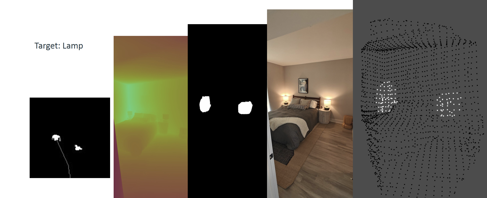

## About Me

I work on enabling robots to navigate and act in unstructured environments using foundation models.

Currently, I'm a student at UIUC  pursuing a MS in Computer Science. I'm advised by <a href="http://daslab.illinois.edu/index.html#girish" target="_blank">Girish Chowdhary</a> at <a href="http://daslab.illinois.edu/index.html" target="_blank"> Distributed Autonomous Systems Lab</a>. My research is focused on Generalized Navigation with Vision Language Action models and embodiment aware grounding for Vision Large Language Models. My research is supported by <a href="https://science.nasa.gov/science-research/earth-science/the-firesense-project/" target="_blank">NASA FireSense</a>, <a href="https://aifarms.illinois.edu/" target="_blank">AIFARMS</a>, <a href="https://i-farm.illinois.edu/" target="_blank">I-FARM</a>, <a href="https://sites.google.com/view/coalescepreview" target="_blank">COALESCE</a>, and <a href="https://access-ci.org/" target="_blank">NSF ACCESS</a>.

Previously, I worked at <a href="https://www.earthsense.co/" target="_blank">Earthsense</a>, on hardware design, autonomy, and optimization for a 750kg payload AGV. My contributions included developing the lower-level control systems and implementing 4-wheel independent torque vectoring for the TerraMax Robot's dual Ackermann steering.

I enjoy running and cycling, currently preparing for a 5k in 25 minutes.

# Education

### <a href="https://illinois.edu/" target="_blank">University of Illinois Urbana-Champaign</a> 
MS in Computer Science

**Relevant coursework:** Humanoid Robotics, Autonomous Vehicle System Engineering, 3D Vision, Networked IoT, Software Engineering, Artificial Intelligence.

### <a href="https://www.coeptech.ac.in/" target="_blank">College of Engineering, Pune</a> 
B.Tech in Mechanical Engineering, Minor in Computer Engineering

**Relevant coursework:** Machine Design, Robotics and Automation, Mechanics of Materials, Engineering Mechanics, Linear Algebra, Vector Calculus.

# Publications

### CATNAV: Cached Vision-Language Traversability for Efficient Zero-Shot Robot Navigation
<small>**Aditya Potnis**, Francisco Affonso, Shreya Gummadi, Naveen Kumar Uppalapati, Girish Chowdhary</small>

Under Review, IROS 2026.

Paper: [Link](https://arxiv.org/abs/2603.22800) \| Website: [Link](https://adipotnis.github.io/catnav-website/)

<video controls><source src="images/catnav_1min.mp4" type="video/mp4"></video>

Zero-shot embodiment-aware traversability framework using multimodal LLMs for costmap generation; visuosemantic caching reduces online VLM queries by 85.7%, achieving 10% higher goal-reaching rate and 33% fewer behavioral constraint violations versus state-of-the-art VLA baselines on a quadruped robot.

### CTS-MoE: Implicit Policy Adaptation Enables Perceptive Locomotion on Discontinuous Terrain
<small>Francisco Affonso, Matheus P. Angarola, Ana Luiza Mineiro, **Aditya Potnis**, Marcelo Becker, Girish Chowdhary</small>

Under Review, CoRL 2026.

Concurrent teacher student architecture for mixture of experts, enabling implicit policy adaptation for perceptive locomotion on discontinuous terrain.

### Visual-Language-Guided Task Planning for Horticultural Robots
<small>Jose Cuaran, Kendall Koe, **Aditya Potnis**, Naveen Kumar Uppalapati, Girish Chowdhary</small>

Under Review, Computers and Electronics in Agriculture.

Paper: [Link](https://www.arxiv.org/abs/2601.11906) \| Website: [Link](https://kendallkoe.com/Visual-Language-Guided-Task-Planning-for-Horticultural-Robots/)

<video controls><source src="images/horticultural_robot.mp4" type="video/mp4"></video>

Modular VLM-guided framework for precision agriculture interleaving natural language queries with action primitives for autonomous crop monitoring, benchmarked long-horizon planning using MLLMs, finding human-comparable performance on short-horizon tasks but degradation in long-horizon scenarios with noisy semantic maps.

more coming soon ...

# Competitive Robotics

  

I am a [FIRST](https://www.firstinspires.org/) and [WRO](https://wro-association.org/) alumni and I have participated in Robotics competitions since 2013. I have represented India Internationally in Robotics competitions thrice and also mentored a team which won Runner up Best Project Research in FLL Europe Opens in Estonia in 2018. I continue to mentor teams at [Robominds](https://www.robominds.in/) for FLL, FTC and Vex Robotics.     

## Achievements 
- Team India Coach, 2018 FIRST Lego League European Championships at Tallinn, Estonia. Team stood 2nd place for Best Project Research and 4th in Overall Robot Game. 
- Team India Representative in [World Robot Olympiad Internationals 2017(Costa Rica)](https://wro-association.org/competition/previous-challenges/),
- Team India Representative 2016(India) in [WRO 2016 Internationals, New Delhi](https://wro-association.org/competition/previous-challenges/), Gold Medal in 2016 Nationals.
- Team India Representative, Top 10 in [First Lego League Open European Championships, Spain(2016)](https://www.firstlegoleague.org/past-challenges) (Fully sponsored by Tata Motors).

# Projects

### Visual Navigation Policy with V-JEPA2 and Diffusion Policy
Code: [Link](https://github.com/adipotnis/DiffusionNav)

<video controls><source src="images/vjepa_vid_gen/clip_jackal_2019-12-19-10-58-43_3_r01.mp4" type="video/mp4"></video>
<video controls><source src="images/vjepa_vid_gen/clip_random_mdps_B_Jackal_GDC_Library_Sat_Nov_13_87_0.mp4" type="video/mp4"></video>

Trained a visual navigation policy using a frozen V-JEPA2 backbone for spatiotemporal feature extraction from egocentric video, with a Diffusion Policy action head for action prediction.

### Adapt: Diffusion-Predicted Pedestrian Avoidance with MPPI Control on the Polaris GEM e4 (CS 588)
Report: [Link](docs/cs588_group10.pdf)

<video controls><source src="images/cs588_group10.mp4" type="video/mp4"></video>

Autonomous driving stack on the Polaris GEM e4 that pairs a diffusion-based pedestrian predictor with an MPPI planner for pedestrian-aware avoidance, plus a text-promptable LiDAR-camera module for open-vocabulary goals.

### Low-Rank Adaptation for Video Generation with semantic relative pose prompts (CS 598 3D Vision, HACKER Project)

Code: [Link](https://github.com/chih-hao-lin/3DV_2025Fall/tree/main/group_09_video_generation/apotnis2_lora_finetune)

<video controls><source src="images/vid-gen-robot.mp4" type="video/mp4"></video>

Fine-tuned Wan 2.2 (1.3B) with LoRA to generate robot-POV navigation videos from text and motion plans for scalable outdoor data synthesis. Evaluated motion fidelity and failure modes, proposing hierarchical motion-primitive curriculum training to improve alignment.

### GhibliDream – Studio-Ghibli inspired Stylization of Stable Diffusion (CS 444)
Report: [Link](docs/CS444-ghiblidream.pdf)

Fine-tuned StableDiffusion-2.0 with DreamBooth on curated Ghibli images using LLM-assisted auto-captioning, achieving 0.90+ CLIP-I cosine similarity on foreground characters while retaining background quality.

### Salto Simulator for development
Code: [Link](https://github.com/adipotnis/gazebo_plugin_salto)

Gazebo plugin simulating [Salto-1P](https://www.youtube.com/watch?v=5tMjHBk-2JQ) jumping motion as a point object, supporting parabolic trajectory jumping and simulated odometry/pose estimation to accelerate autonomy development.

### Design and Analysis of Tendon actuated Robotic arm using Bowden cables and Mechanical Multiplexing (Thesis @ COEP)
Report: [Link](docs/robotic_arm_mux_report.pdf)

Designed a modular 4-DOF Bowden cable-driven tendon-actuated robot arm with a mechanical multiplexer enabling full control with only 2 stepper motors, prototyped with FDM printing and including FK/IK solvers. Awarded Best Working Project (Mechanical) at COEP; provisional patent filed (IN202321006687).

### ROS1 ROS2 bridge for faster debugging and code refactoring
- Created a Docker image generation repo to accelerate image creation and facilitate easier refactoring. [Link](https://github.com/adipotnis/ros1_bridge_ws)

### VLM assisted Octomap generation for navigation

<video controls><source src="images/octomap-proj-1.mp4" type="video/mp4"></video>

Implemented open-vocabulary segmentation with CLIPSeg and stereo depth-based point cloud generation via Open3D to build octomaps for 3D robot navigation, tested on the NVIDIA r2b_2023 dataset.

### Semantic-aware segmentation and navigation using CLIPSeg (CS440)
Slides: [Link](docs/smartnav.pdf) Report: [Link](docs/CS440-Final-Project.pdf)

Combined CLIPSeg with Depth-Anything V2 for obstacle-aware gridmap generation (94% accuracy); modified A* planner with goal-object validation achieves 81% success rate for line-of-sight pathfinding.

---
##### Made using [minimal-mistakes](https://github.com/mmistakes/minimal-mistakes)
