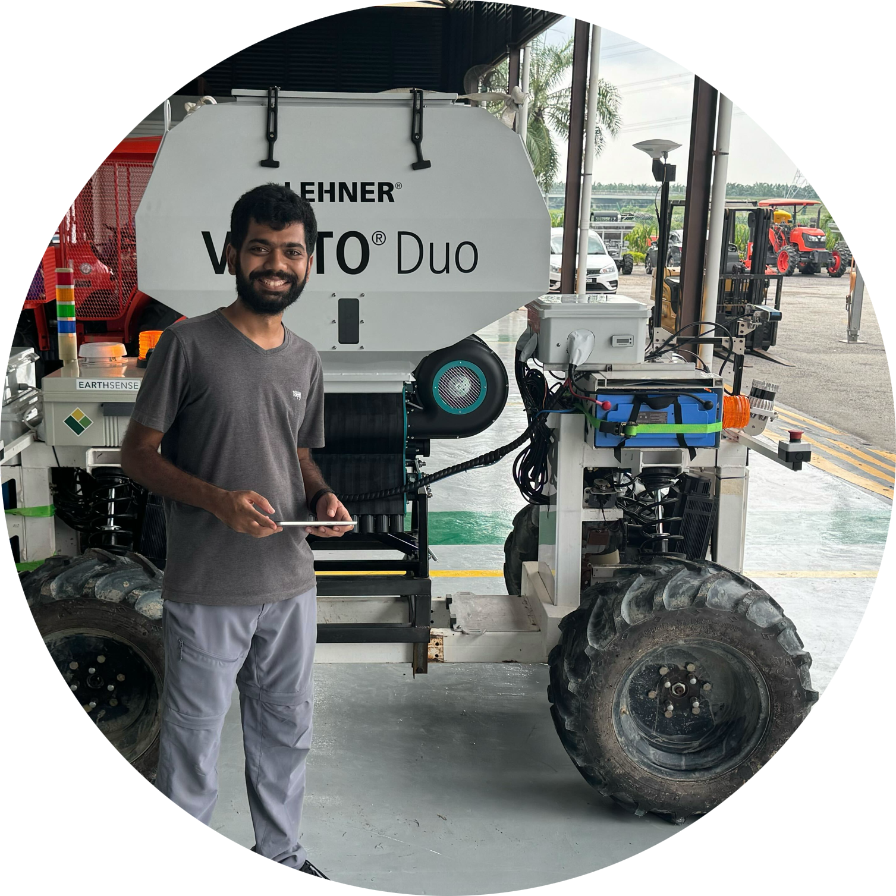
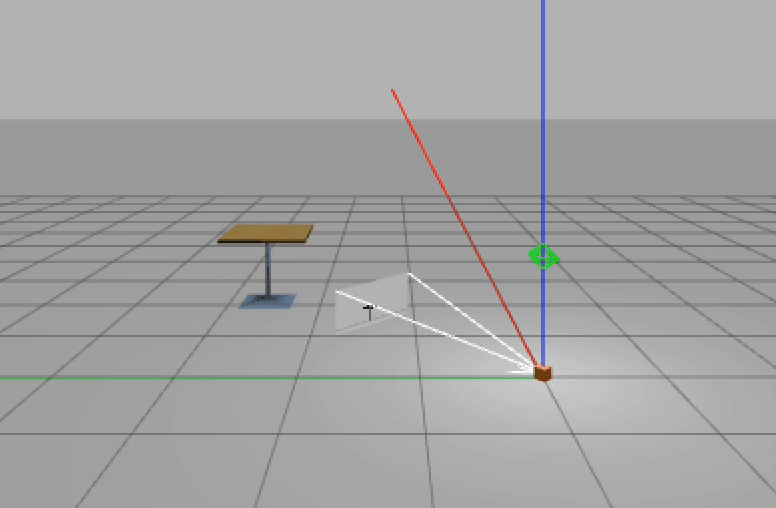
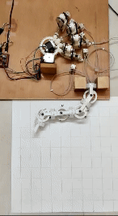
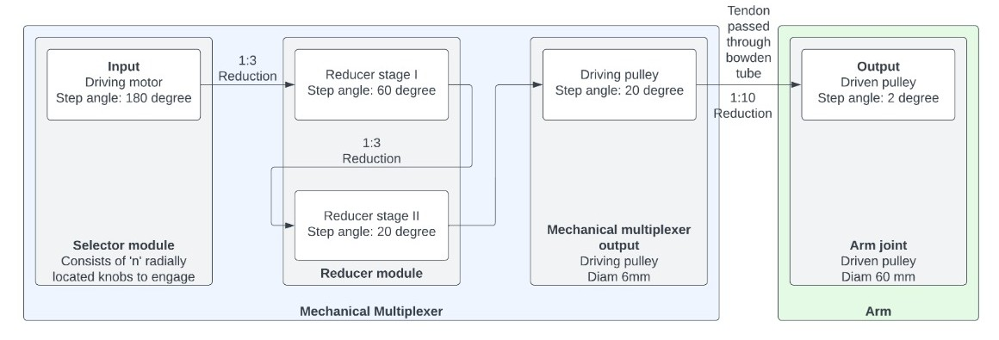
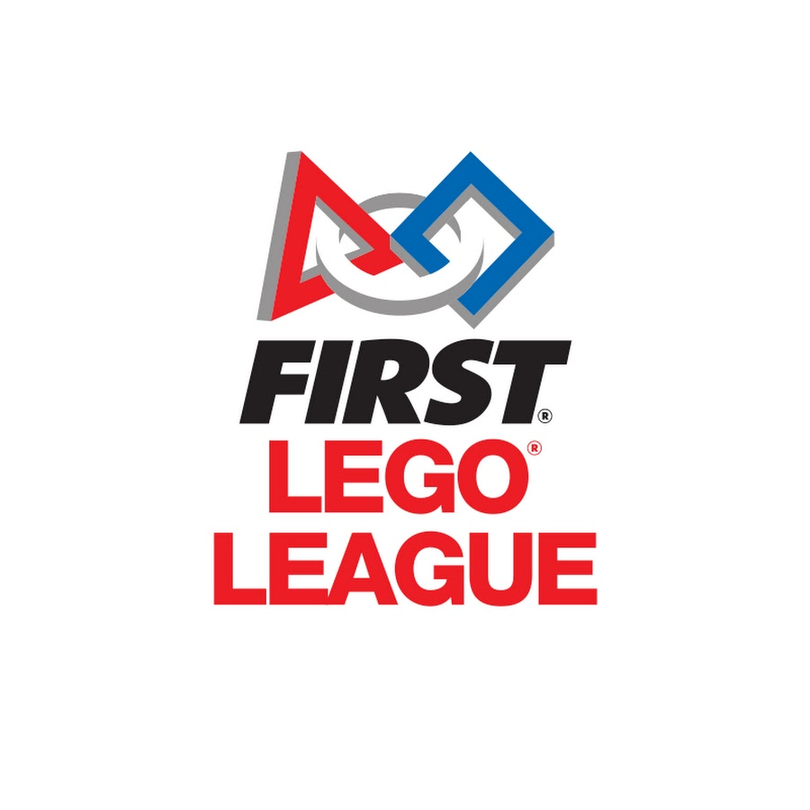

<h2 style="font-size: 2rem; margin-bottom: 1.5rem;">About Me</h2>

Hey! I'm Aditya - a full stack roboticist with experience spanning hardware design, lower level control and semantic autonomous navigation specializing in semistructured and unstructured environments. My goal is to work on Robust, Scalable and Adaptable solutions using control theory and robot learning to solve complex real-world problems. 

 Currently, I am a graduate student at University of Illinois Urbana Champaign  pursuing a Master of Science in Computer Science with a concentration in Robotics. I work as a Research Assistant under the guidance of Prof. Girish Chowdhary at <a href="http://daslab.illinois.edu/index.html" target="_blank">Distributed Autonomous System Lab</a>(UIUC). My research is focused on Visual Language Model(VLM) assisted navigation methods for generalization with different types of motion primitives.

  
I previously did my B.Tech in Mechanical Engineering with a Minor in Computer Engineering at <a href="https://www.coeptech.ac.in/" target="_blank">College of Engineering, Pune</a>  and worked for 2.5 years on the hardware design, autonomy, ROS2 refactoring, MPPI performance optimization and lower level controls for a 750 kg self-driving heavy payload agriculture AGV at <a href="https://www.earthsense.co/" target="_blank">Earthsense</a>. I also developed the 4-wheel independent torque vectoring for the Dual Ackermann steer mechanism for the TerraMax Robot. 

Feel free to connect with me on <a href="https://www.linkedin.com/in/adityapotnis/" target="_blank">
   LinkedIn
</a>

<a href="https://www.youtube.com/watch?v=1CN3ZjOrtVQ" target="_blank">Watch video</a>

more coming soon ...

# Projects

### Smart semantic segmentation and navigation using CLIPSeg
Slides: [Link](docs/smartnav.pdf)

Report: [Link](docs/CS440-Final-Project.pdf)

- Combined CLIPSeg with Depth-Anything V2 to detect target objects and risky obstacles, generating obstacle-aware gridmaps for navigation for object & obstacle awareness and 94% accuracy for adaptive scene understanding.
- Designed a modified A* planner with goal-object validation, achieving an average 81% success rate and ±9% distance accuracy for line of sight target based pathfinding across varied indoor & outdoor scenes.
- Compared CLIP and DINOv2 feature embeddings to quantify scene understanding perfomance across indoor and outdoor spaces.  

### GhibliDream – Studio-Ghibli inspired Stylization of Stable Diffusion (CS 444) 
Report: [Link](docs/CS444-ghiblidream.pdf)
- Fine-tuned StableDiffusion-2.0 for stylization with DreamBooth on curated images using a T4/A100 instance.
Built a LLM-assisted (Gemini-2.0/GPT4o based) image auto-captioning workflow to generate variation of text
length, tone and styles.
- Stress tested system via targeted ablation of samplers & prompt length. Reached 0.90+ CLIP-I cosine similarity
on foreground characters while retaining backgrounds quality.

### Salto Simulator for development
- Simulates [Salto-1P](https://www.youtube.com/watch?v=5tMjHBk-2JQ) jumping motion as a point object (Jumping cube) to help accelerate autonomy development. Allows for parabolic trajectory jumping with continous as well as periodic jumps.
- Simulates odometry, pose estimation and the required control action for the actual robot.
- Repo to be released soon.

### VLM assisted Octomap generation for navigation
- Implemented vision and stereo depth based point cloud generation to create a octomap for robot navigation in 3d space.
- Performed open vocabulary segmentation via clipseg and point cloud generation via open3d for risk / inflation boundary creation.
- Tested on the nvidia r2b_2023 dataset.
<video width="220" height="315" controls>
  <source src="images/octomap-proj-1.mp4" type="video/mp4">
  Your browser does not support the video tag.
</video>

### ROS1 ROS2 bridge for faster debugging and code refactoring
- Created a Docker image generation repo to accelerate image creation and facilitate easier refactoring. [Link](https://github.com/adipotnis/ros1_bridge_ws)

### Design and Analysis of Tendon actuated Robotic arm using Bowden cables and Mechanical Multiplexing (Thesis @ COEP)
- Led team in designing a modular 4 degree of freedom Bowden cable driven, tendon actuated joint for robot modular planar and non-planar robot arm as part of Final year project at COEP. System is compact, lightweight and waterproof with remotely positioned actuators. Designed in Fusion 360 and analysed failure modes using ANSYS structural FEA.
- Mechanical Multiplexer allows multijointed arm to be controlled by only 2 stepper motors, reducing overall cost and size of system. Modular joints can be swapped easily to quickly modify degree of freedom of arm.
- Prototyped design using FDM 3D printing with PLA, And CNC stepper and Arduino control.
- Developed Forward Kinematics (FK) and Inverse Kinematics (IK) control for arm with Numerical optimization method. 
- Project awarded Best Working project award (Mechanical) by 1982 batch, Alumni association.
- Patent pending. Provisional patent done (IN202321006687).

 

# Competitive Robotics

  

I am a [FIRST](https://www.firstinspires.org/) and [WRO](https://wro-association.org/) alumni and I have participated in Robotics competitions since 2013. I have represented India Internationally in Robotics competitions thrice and also mentored a team which won Runner up Best Project Research in FLL Europe Opens in Estonia in 2018. I continue to mentor teams at [Robominds](https://www.robominds.in/) for FLL, FTC and Vex Robotics.     

## Achievements 
- Team India Coach, 2018 FIRST Lego League European Championships at Tallinn, Estonia. Team stood 2nd place for Best Project Research and 4th in Overall Robot Game. 
- Team India Representative in [World Robot Olympiad Internationals 2017(Costa Rica)](https://wro-association.org/competition/previous-challenges/),
- Team India Representative 2016(India) in [WRO 2016 Internationals, New Delhi](https://wro-association.org/competition/previous-challenges/), Gold Medal in 2016 Nationals.
- Team India Representative, Top 10 in [First Lego League Open European Championships, Spain(2016)](https://www.firstlegoleague.org/past-challenges) (Fully sponsored by Tata Motors).

---
##### Made using simplest-jekyll  

Source: 

